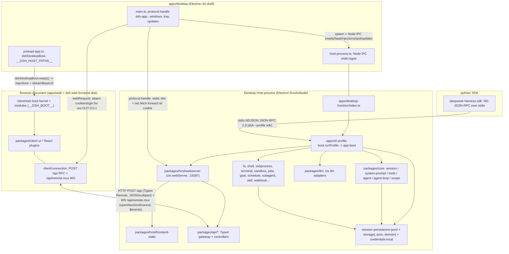

# DeepSeek Harness — Architecture Map (reverse-engineering, pinned commit 477b4f420553e8a52c2fbccc464d7561b239c443, v0.1.7-rc.2)

All paths are relative to `_upstream/` (the pinned reference checkout). Every claim cites a repository path, with `:line` where it pins the exact evidence. Where a fact could not be established from source, the text says "NOT DETERMINED FROM SOURCE" and names what was inspected. This document is the architecture basis for a desktop port; the companion document is `docs/analysis/dependency-service-inventory.md`.

## 1. Top-level composition: how `dsh` boots

`dsh` is an "everything is a plugin" Cordis harness: model adapters, tool registry, session log, and the agent loop are all plugins, each replaceable from configuration (`docs/architecture.md:11`, `docs/architecture.md:13`). A running `dsh` is a plugin tree composed at boot from ordered layers (`docs/architecture.md:17`).

### 1.1 Boot pipeline (packages/boot, apps/cli)

The single application entry is the `dsh` CLI (`apps/cli/package.json:15` declares the `dsh` bin as `lib/bin.js`; the repository source launch is `node --import tsx/esm apps/cli/src/bin.ts`, root `package.json:197`). `apps/cli/src/` contains `bin.ts`, `args.ts`, `profile-boot.ts`, `dump-config.ts`, `plugin.ts`, `process-shutdown.ts`, `startup-diagnostics.ts` (`apps/cli/src/*`, directory listing). `verify-application-entrypoints` enforces that every supported Node application launches through named `dsh` profiles — package bins, demos, and argv escapes are rejected (`docs/architecture.md:45`, `docs/architecture.md:47`).

The shared launcher is `runProfile()` in `apps/cli/src/profile-boot.ts:244`; its module doc states it resolves the profile, stacks its patch layers (bundle layers in `dsh.profile.bundles` order, the profile's own `cordis.patch.yml`, `--patch` overlays, the telemetry switch), mounts the tree over the profile's empty root config, and wires fail-loud plus bounded shutdown (`apps/cli/src/profile-boot.ts:1-11`). Concretely:

1. `installProxyFromEnvironment()` installs proxy handling from the frozen launch-environment snapshot before any plugin mounts (`apps/cli/src/profile-boot.ts:249-252`).
2. `composeProfile()` loads the profile via `loadProfile`, computes an immutable `RuntimeResolution` (bare-name module interception table) and parses `--patch` overlay files (`apps/cli/src/profile-boot.ts:197-209`).
3. The root config is an empty entry list, `PROFILE_ROOT_CONFIG` at `apps/cli/src/profile-boot.ts:81-85`, rewritten every boot into `cordis.yml` inside the profile directory (`apps/cli/src/profile-boot.ts:167-173`) — the whole composition is patches, so the Loader write-back cannot bake rows into the root.
4. `boot()` from `@deepseek-ai/dsh-app-boot` mounts the tree; before any entry mounts the launcher provides `profileContext`, the immutable `DSH_LAUNCH_ENVIRONMENT_KEY` snapshot, the `PluginPackages` runtime resolution, and `provideCmdline` (args, `exit`, `ready`) (`apps/cli/src/profile-boot.ts:296-312`).
5. Layer order: each bundle in the profile's listed order, then the profile's `cordis.patch.yml`, then the home-level `$DSH_HOME/cordis.patch.yml`, then any `--patch` overlay (`docs/architecture.md:27`; home layer at `apps/cli/src/profile-boot.ts:73-75` and `apps/cli/src/profile-boot.ts:187-190`).
6. `installFailLoud` plus SIGTERM/SIGINT handlers own teardown (SIGTERM exits 0, SIGINT 130) (`apps/cli/src/profile-boot.ts:276-284`).

`packages/boot/app-boot` owns profile resolution, patch composition, the runtime resolution, fail-loud, and `PROFILE_TEMPLATES` (`packages/boot/app-boot/src/profile.ts:179-195`, exported through `packages/boot/app-boot/src/index.ts:68`). `packages/boot/plugin-manager` (`ctx.pluginManager`) manages profile files and applies their declared reload lifecycle — install/remove bundles through pnpm, enable/disable plugins, version exemptions (`docs/subsystems/boot.md:5`, `docs/subsystems/boot.md:87-178`). `packages/boot/config-editor` (`ctx.configEditor`) persists complete raw configs and applies them through the normal Loader path (`docs/subsystems/boot.md:31-54`). `packages/boot/hmr` (`ctx.hmr`) is config-only hot reload, coordinated by YAML: base enables it; headless, SDK, and ACP disable it; `sdk-minimal` omits it (`docs/architecture.md:29`). `packages/boot/cmdline` provides the `ctx.cmdlineArgs`/exit/ready provider used above (`apps/cli/src/profile-boot.ts:38`).

### 1.2 Profiles and bundles

A **profile** is a named composition stored in the Harness home: it lists the bundles it stacks, holds out-of-tree plugin installs, and keeps the user's `cordis.patch.yml`; `web`, `headless`, `sdk`, `sdk-minimal`, `acp` ship as templates (`docs/architecture.md:19`). A **bundle** is a distribution format for Cordis config rows and the code they mount; each declares `dsh.profile` (a profile's bundles) or `dsh.bundle` (a bundle's patch file) in its `package.json` (`docs/architecture.md:21`, `docs/architecture.md:23`). Profile directories live at `$DSH_HOME/profiles/<name>` (`packages/boot/app-boot/src/profile.ts:169-176`).

The shipped templates (`packages/boot/app-boot/src/profile.ts:179-195`):

| Profile | Bundles | Notes |
|---|---|---|
| `web` | `@deepseek-ai/dsh-base`, `@deepseek-ai/dsh-web-app` | Browser application (`docs/architecture.md:25`) |
| `headless` | `@deepseek-ai/dsh-base`, `@deepseek-ai/dsh-headless` | One-shot runner, no server (`docs/architecture.md:25`) |
| `sdk` | `@deepseek-ai/dsh-base`, `@deepseek-ai/dsh-sdk-app` | SDK JSON-RPC server (`docs/architecture.md:25`) |
| `acp` | `@deepseek-ai/dsh-base`, `@deepseek-ai/dsh-acp-app` | Automation-only ACP server (`docs/architecture.md:25`) |
| `sdk-minimal` | `@deepseek-ai/dsh-sdk-minimal` | Deliberate exception: one bundle owns its complete explicit SDK tree and does not apply `dsh-base` (`docs/architecture.md:25`) |

Optional shipped bundles a user may switch on are `@deepseek-ai/dsh-experimental-agent-team-profile`, `@deepseek-ai/dsh-experimental-voice-input-bundle`, `@deepseek-ai/dsh-experimental-auto-review` (`packages/boot/app-boot/src/profile.ts:213-217`). The reserved Desktop profile `desktop` is not a CLI template: Electron exclusively owns `$DSH_HOME/profiles/desktop` and the public CLI cannot manage it (`docs/architecture.md:53`, `apps/desktop/README.md:66`, `apps/desktop/README.md:77`).

What each layer mounts (row ids from the bundles' `cordis.patch.yml`, one `insert` per bundle — `packages/bundle/base/cordis.patch.yml:1-14` explains the layering rules):

| Bundle | Patch file | What it mounts (row ids) |
|---|---|---|
| `dsh-base` | `packages/bundle/base/cordis.patch.yml` | ~120 rows: `plugin-manager`, `hmr`, `llm`, `llm-deepseek` (`dsh-llm-deepseek-api-key`), `llm-deepseek-account`, `llm-pi-ai`, `llm-retry`, `session`, `session-persistence-jsonl` (root `dshHomePath('sessions')`, line 130-133), `session-log-deepseek`, `session-title` + `session-title-llm`, `agent`, `agent-loop`, `agent-default-model`, `typert`/`typert-loader`/`typert-gateway`, `config-editor`, `settings`, `authorization`, `deepseek-account`, `credentials` (`dsh-credentials-local`, line 117-118), `attachment-local`, `session-query-sqlite` (default `path: ':memory:'`, `openAt: never`, lines 149-153), `session-projection`, `storage`/`storage-json` (root `dshHomePath('storages')`, lines 165-171)/`storage-domain`, `session-projection-cache`, `session-telemetry-otel`, `subprocess`, `sandbox`/`sandbox-policy`/`bash-sandbox`/`pwsh-sandbox`, `approval`, `permission`, `shell-env`, `tool-bash`/`tool-pwsh`/`tool-jobs`/`tool-fs`/`tool-fs-search`/`tool-skill`/`tool-todo`/`tool-goal`/`tool-web`/`tool-subagent*`/`tool-workflow`/`tool-ralph` (disabled)/`tool-plugin-manager`, `commands`, `goal`/`goal-round-driver`/`command-goal`, `plan-mode`, `token-meter`, `compaction-basic`/`command-compact`/`tool-result-pruner`/`image-offload`, `subagent` + `subagent-spawn-in-process`/`subagent-fork-in-process`, `ptc-runtime`/`workflow-ptc`, `timeout-policy`, `spill-local`/`spill-policy`, `session-checkpoint-policy`, `repeat-tool-reminder`, `web`/`web-search-deepseek`/`web-fetch-http`, `mcp-resources`, `tools`, `system-prompt`, `fs-sandbox` |
| `dsh-web-app` | `packages/bundle/web-app/cordis.patch.yml` | Web transport and GUI: `web-startup`, `webserver` (`dsh-host-webserver`, default `port: ctx.webStartup.port ?? 3080`, lines 163-171), `web-runtime` (`dsh-web-app`, frontend dist + URL printing), `client-hmr`, `modules` (`dsh-client-modules`, composes `window.__DSH_BOOT__`), `connection` (`dsh-client-connection`, line 210-217), `file-upload`, `api-remotes`, the API controllers (`session-controller`, `job-controller`, `terminal-controller`, `workspace-files`, `account-controller`, `settings-controller`, `workspace-controller`), `office-to-pdf`, `workspace`, `session-reference`, `session-stats`, `session-turn-outline`, `directory-picker`, `plugin-inventory`, `schedule`, `time-context`, and ~50 `ui-*` client plugin rows (lines 230-441); it also re-asserts tool rows and mounts `agent-preset-registry` (lines 444-562) and ships agent presets under `packages/bundle/web-app/presets/*.patch.yml` (e.g. `tool-cordis`, `tool-subagent-codex`, `tool-subagent-claude-code`, `office`-adjacent skills — `packages/bundle/web-app/presets/cordis.patch.yml:5-152`) |
| `dsh-headless` | `packages/bundle/headless/cordis.patch.yml` | `headless-startup`, `headless-runner` (one-shot), restates `system-prompt`/`tools`, disables `hmr` (lines 9-33) |
| `dsh-sdk-app` | `packages/bundle/sdk-app/cordis.patch.yml` | `sdk-app-startup`, `sdk-jsonrpc-server` (`dsh-sdk-jsonrpc-server`), restates `system-prompt`/`session-title-llm`, disables `hmr` (lines 3-24) |
| `dsh-acp-app` | `packages/bundle/acp-app/cordis.patch.yml` | Automation-only ACP server rows (`docs/architecture.md:25`) |
| `dsh-sdk-minimal` | `packages/bundle/sdk-minimal/cordis.patch.yml` | Complete explicit SDK tree without `dsh-base` (`docs/architecture.md:25`) |

## 2. Desktop application architecture (apps/desktop, apps/desktop-host)

The desktop application is an Electron shell around the complete dsh Web application (`apps/desktop/README.md:5`). Release identity is deliberately unitary: Electron and `@deepseek-ai/dsh` always carry the same exact version, and the Electron shell, matching dsh runtime, and bundled pnpm form one signed update unit (`apps/desktop/README.md:63`, `apps/desktop/README.md:69`).

### 2.1 Process topology and the Desktop Host

- The Electron main process is `apps/desktop/src/main.ts` (bundled to `lib/main.js`, `apps/desktop/package.json:8`); the runtime resources it resolves are Electron-as-Node (`process.execPath`), a bundled `pnpm` (`resources/runtime/pnpm/bin/pnpm.mjs`), a `node` shell launcher (`runtime/bin`, `apps/desktop/scripts/node-bin/` in development), and the packaged dsh tree (`resources/app.asar/dsh`) — `apps/desktop/src/main.ts:140-157`.
- Electron starts the private **Desktop Host** as a Node-mode child (`ELECTRON_RUN_AS_NODE=1` with `--expose-internals`) running `dsh-desktop-host/lib/index.js` (`apps/desktop/src/host-process.ts:186-201`; environment assembly in `apps/desktop/src/node-environment.ts`). The spawn passes `runtimeDir`, the Desktop profile `projectDir`, `primaryRuntime`, and the bundled pnpm entry + node-bin dir (`apps/desktop/src/host-process.ts:189-197`).
- The Host (`apps/desktop-host/src/index.ts`) invokes the shared CLI profile runner and complete Web application: `runProfile({ profile: 'desktop', resolvedProfile: { profile: loadProfileDirectory('dsh', projectDir, installAnchor), installAnchor }, args: ['--no-open', '--port', '19387'], ... })` (`apps/desktop-host/src/index.ts:25-42`). Both host and plugins execute in the same Electron Node-mode process; plugin package operations use the bundled pnpm (`apps/desktop/README.md:77`, `apps/desktop/README.md:11`).
- `apps/desktop-host/src/index.ts` also installs `installDesktopUpdateTaskControl`, `installDesktopQuitInspection`, `installPlatformSessionPublisher`, and the desktop office-engine resolution (`apps/desktop-host/src/index.ts:93-102`, `apps/desktop-host/src/office.ts`, `apps/desktop-host/src/office-engine.ts`).

### 2.2 Port 19387 — what listens

`19387` is passed as the web-application port argument (`apps/desktop-host/src/index.ts:30`); the listener is the same `dsh-host-webserver` (`ctx.webServer`) plugin that serves the Web product — a single `node:http` plugin with a named-route registry (`docs/subsystems/web-server.md:5`, `packages/host/webserver/src/index.ts`). Desktop defaults to `19387`, separate from Web's `3080`, and a `webserver.config.port` patch can override it (`apps/desktop/README.md:5`); the `webserver` row's fallback config is `ctx.webStartup.port ?? 3080` (`packages/bundle/web-app/cordis.patch.yml:168`). The Host reports `ctx.connection.authenticatedUrl('http://127.0.0.1:' + ctx.webServer.port)` to Electron (`apps/desktop-host/src/index.ts:103`), i.e. the launch token is exchanged into the authenticated browser URL. A `listen EADDRINUSE 127.0.0.1:19387` failure is special-cased in native recovery with "quit other running DSH instances" guidance (`apps/desktop/README.md:105`, `apps/desktop/tests/fatal-recovery.spec.ts:37`).

### 2.3 Packaged Web assets and the `dsh-app://` protocol

The main process registers the privileged `dsh-app:` scheme (standard, secure, fetch, CORS, stream, codeCache) (`apps/desktop/src/main.ts:128-138`) and serves it with `protocol.handle` (`apps/desktop/src/main.ts:617-632`):

- `dsh-app://shell/...` serves shell-owned documents from `apps/desktop/renderer` (update dialog, mandatory-update overlay, welcome page) and never touches the Host (`apps/desktop/src/main.ts:619-620`, `apps/desktop/README.md:83`).
- `dsh-app://app/`, `/index.html`, `/assets/*`, favicon, and manifest are served from the **packaged Web assets**: `<dsh>/node_modules/@deepseek-ai/dsh-web-frontend/dist` (`apps/desktop/src/main.ts:621-625`) — that is the Vite build of `apps/web` (`apps/web/package.json:2-3`).
- Every other `dsh-app://app/...` request is forwarded over Node `net.fetch` to the authenticated Web Host with the stored host cookie (`forwardWebRequest`, `apps/desktop/src/web-document.ts`), dropping connection-level response headers and marking plugin bundles `no-store` (`apps/desktop/README.md:5`); a missing backend answers 503 (`apps/desktop/src/main.ts:626-629`).

The window therefore loads the same document the browser Web product uses; there is no separate desktop renderer app.

### 2.4 Boot injections and the desktop carrier

**Boot injections** are the structured `IndexInjection` rows the Host would otherwise render into `index.html`: `ctx.webServer.collectIndexInjections()` gathers them over one `webserver/index-inject` emit (`docs/subsystems/web-server.md:51`, `docs/subsystems/web-server.md:210-225`), and `dsh-client-modules` answers with the boot manifest rows — client bundle script-preloads and the `globalThis["__DSH_BOOT__"]` entry graph (`packages/client/modules/src/index.ts:552`, `packages/client/modules/src/index.ts:585`, `packages/client/modules/src/index.ts:655`). The static page cannot receive server-rendered HTML, so the sequence is:

1. The shared loading page (the packaged Web entry) boots offscreen before profile preparation or backend startup (`apps/desktop/README.md:97`).
2. The app preload exposes `dshDesktopBoot` only to `dsh-app://app` main-frame documents (`apps/desktop/src/preload-app.ts:84`, `apps/desktop/src/preload-app.ts:99`).
3. `apps/web/src/main.ts:24-35` awaits `desktop.ready()`, sets `globalThis.__DSH_TRANSPORT__ = { ownsHost: true, streamBaseUrl }`, then `applyIndexInjections(injections, ...)` appends each injected `<script>` in order and resolves the `__DSH_BOOT_READY__` gate before client plugins activate in the same document.
4. The Host supplies those injections on the Node IPC `ready` message: `process.send({ type: 'ready', url, injections: ctx.webServer.collectIndexInjections() })` (`apps/desktop-host/src/index.ts:104`), and Electron stores them (`apps/desktop/src/main.ts:419-420`; a missing table is a hard error: `apps/desktop/src/main.ts:419`).
5. `DESKTOP_IPC.boot` returns `{ injections, streamBaseUrl: new URL(hostUrl).origin }` to the page (`apps/desktop/src/main.ts:640-645`); a replacement Host can change port, cookie, or injections at the same URL (`apps/desktop/src/main.ts:507`).

The **desktop carrier** is the composition of that transport override plus Electron's request mediation: `__DSH_TRANSPORT__.streamBaseUrl` gives the Gateway the HTTP origin of its owned Host for the WebSocket while HTTP transport stays independently selected, and "the desktop carrier owns authentication; setting the origin alone grants no access" (`packages/client/connection/README.md:28`). In practice Electron (a) forwards HTTP through `protocol.handle` with the authenticated host cookie (`apps/desktop/src/main.ts:629`), and (b) attaches credentials to WebSocket streams only for the owned application window: `session.defaultSession.webRequest.onBeforeSendHeaders({ urls: ['ws://127.0.0.1/*'] })` rewrites `origin` to the Host origin, injects `cookie: hostCookie` and `sec-fetch-site: same-origin`, and cancels any other origin (`apps/desktop/src/main.ts:665-676`). The cookie itself comes from `authenticateWebHost(ready.url)` (`apps/desktop/src/main.ts:417`), the same browser-session cookie flow described in section 3.3.

### 2.5 Node IPC channel (Electron ⇄ Desktop Host)

The channel is Node child-process IPC (`stdio: ['ignore','pipe','pipe','ipc']`, `apps/desktop/src/host-process.ts:200`). The message taxonomy is validated by `isDesktopHostEvent` (`apps/desktop/src/host-process.ts:53-91`):

| Direction | Message type | Payload | Purpose | Evidence |
|---|---|---|---|---|
| Host → Electron | `ready` | `url`, `injections?` | Authenticated browser URL + boot injections | `apps/desktop-host/src/index.ts:104`, `apps/desktop/src/host-process.ts:212` |
| Host → Electron | `fatal` | `message`, `diagnostic?` | Startup failure reported before exit (stderr races IPC, so the inspected error rides here) | `apps/desktop-host/src/index.ts:110-121`, `apps/desktop/src/host-process.ts:218` |
| Host → Electron | `platform-session` | `session: PlatformSession \| null` | Private credential updates for embedded Platform views (never reaches renderer RPC) | `apps/desktop-host/src/index.ts:100-102`, `apps/desktop/README.md:13` |
| Host → Electron | `shutdown-complete` | — | Graceful teardown acknowledged | `apps/desktop-host/src/index.ts:56`, `apps/desktop/src/host-process.ts:214-217` |
| Host → Electron | `update-tasks` | `requestId`, `active`, `error?` | Answer to update task inspection/lock/unlock | `apps/desktop-host/src/index.ts:78-89`, `apps/desktop/src/host-process.ts:243-247` |
| Host → Electron | `quit-inspection` | `requestId`, `activeTasks`, `scheduledTasks`, `error?` | What quitting would interrupt (2 s deadline) | `apps/desktop-host/src/index.ts:62-77`, `apps/desktop/src/host-process.ts:254-258` |
| Electron → Host | `shutdown` | — | Start teardown (10 s graceful, then SIGTERM, then SIGKILL) | `apps/desktop-host/src/index.ts:61`, `apps/desktop/src/host-process.ts:288-308` |
| Electron → Host | `quit-inspection` / `update-tasks` | `requestId`, `action` | Requests answered above | `apps/desktop/src/host-process.ts:260-280` |

Unrecognized messages are a fatal protocol failure (`apps/desktop/src/host-process.ts:206-210`). Host stderr is retained as a bounded 64 KiB tail for crash reports (`apps/desktop/src/host-process.ts:203-204`, `apps/desktop/README.md:107`).

### 2.6 Desktop-only shell behavior (relevant to a port)

Single-instance ownership: Electron acquires a process-lifetime single-instance lock before any profile access and exclusively owns `$DSH_HOME/profiles/desktop` plus its package-manager state; CLI and Desktop share supported product data under `$DSH_HOME` but never executable packages, plugin activation, lockfiles, or `node_modules` (`apps/desktop/README.md:66`, `apps/desktop/src/single-instance.ts`). Profile preparation validates `resources/app.asar/dsh/desktop-runtime.json` (shell version, Electron Node version, platform/arch, shared package versions, file inventory) without running pnpm at startup (`apps/desktop/README.md:95`, `apps/desktop/README.md:98`, `apps/desktop/src/runtime-tree.ts`, `apps/desktop/src/project-manager.ts`). Fatal failures open one native recovery dialog per process with Exit / Restart / Disable third-party plugins (which renames `cordis.patch.yml` to a timestamped `.bak` under the profile transaction lock) (`apps/desktop/README.md:105`, `apps/desktop/README.md:111`, `apps/desktop/src/fatal-recovery.ts`). Updates run through `electron-updater`-backed coordination (`apps/desktop/src/update-coordinator.ts`, `apps/desktop/src/update-http-executor.ts`) with mandatory-update policy windows (`apps/desktop/src/mandatory-update-policy.ts`, `apps/desktop/src/mandatory-update-window.ts`); packaging/signing/installer scripts live in `apps/desktop/scripts/` (electron-builder config `apps/desktop/scripts/electron-builder-config.mjs`, NSIS `apps/desktop/scripts/installer.nsh`, Windows signing `apps/desktop/scripts/windows-sign.mjs`, macOS notarization `apps/desktop/scripts/notarize-macos.mjs`, runtime payload `apps/desktop/scripts/prepare-primary-runtime.ts`). The Desktop preload exposes only boot readiness, fatal startup reporting, native directory selection, `__DSH_HOST_PATHS__`, and a lease-scoped Browser bridge; "No renderer receives filesystem access, raw Electron IPC, a shell, or arbitrary pnpm arguments" (`apps/desktop/README.md:79`).

## 3. Web application architecture (apps/web, packages/host/*, packages/api/*, packages/client/connection)

### 3.1 Surfaces

`apps/web` is the Vite/React browser entry: package `@deepseek-ai/dsh-web-frontend`, "vite build over the `@deepseek-ai/dsh-client-web` shell library; dist/ served by apps/cli's `dsh web`" (`apps/web/package.json:2-3`), with the browser entry `apps/web/src/main.ts` and Vite config `apps/web/vite.config.ts` (which refuses bare Vite because "only `dsh web` injects `window.__DSH_BOOT__`", `apps/web/vite.config.ts:11`, `packages/bundle/web-app/src/index.ts:144`). On the Host side, `packages/host/webserver` (`ctx.webServer`) is the plain HTTP carrier — named routes, one fallback seat, gzip, index-injection rendering; "Electron loads the built files over `file://` and sends fetch requests through an IPC bridge instead of this server" for desktop (`docs/subsystems/web-server.md:5`). `packages/host/frontend-static` claims the fallback seat as the SPA dist server with locked semantics (Connection authenticates the dist root/index; assets stay public; traversal 403) (`docs/subsystems/web-server.md:27`).

### 3.2 How the browser UI talks to the backend — the exact wire protocol

The protocol is the **Typert Remote RPC** carried by `@deepseek-ai/dsh-client-connection`, over two physical carriers:

1. **Unary calls: HTTP POST to `/api`.** "The browser uses HTTP POST for Remote unary calls" (`packages/client/connection/README.md:32`); "Unary RPC requests use JSON", with optional byte attachments returned as multipart parts whose `metadata` part is the RPC response envelope with an attachment table (`packages/client/connection/README.md:30`). Business methods are `@Remote`/`@RemoteScope`-marked methods on `TypertRemoteService` classes, described by generated `InvocationDescriptor` contracts (`packages/api/gateway/README.md:27`); the vocabulary types (`RemoteStream<Out, In>`, `RemoteStreamHandle`, `@Remote`) are defined in `packages/typert/protocol` (`packages/api/gateway/README.md:39`, `docs/subsystems/typert.md`). The `/api` route is the shared Fetch bridge mounted by Connection (`createSharedFetchHandler(channel: '/api')`, `docs/subsystems/web-server.md:75`).
2. **Streams: one multiplexed WebSocket at `/api/remote.mux`.** "API Gateway owns the `/api/remote.mux` WebSocket and its logical streams" (`packages/client/connection/README.md:32`); each logical stream is independently cancellable and carries a Client→Host uplink on the same stream with `open`/`item`/`end`/`cancel` frames (`packages/api/gateway/README.md:35`, `packages/api/gateway/README.md:39`). The shared stream framing/parser is exported as `@deepseek-ai/dsh-api-gateway/stream-protocol`, "the shared Remote stream framing and parser to native Desktop callers… These callers use the same authenticated WebSocket endpoint as the browser client" (`packages/api/gateway/README.md:103`). The Host pings at `websocketHeartbeatIntervalMs` (default 2 s) and drops peers missing a Pong (`packages/api/gateway/README.md:35`).
3. **Host events** ride the reserved internal `$events` logical stream, whose opening item `{ type: 'ready', clientId, host: { home } }` establishes a Connection generation before any incremental event (`packages/api/gateway/README.md:43`, `packages/client/connection/README.md:52`). Browser consumption is `ctx.remote.$on()` and `$stream()` (snapshot/journal variants included) (`packages/api/gateway/README.md:58-60`).

Where each layer is defined: generated invocation descriptors and codecs — `packages/typert/{protocol,generator,loader,registry}` (`docs/subsystems/typert.md`); Host dispatch/validation/cancellation — `ctx.typertGateway` in `packages/api/gateway` (`packages/api/gateway/README.md:25-43`); client face — `ctx.remote` (`@deepseek-ai/dsh-api-gateway/client`, `packages/api/gateway/README.md:45-66`); carrier, trust fence, envelopes, reconnect generations — `packages/client/connection` (`packages/client/connection/README.md:12`, `packages/client/connection/README.md:49-58`); business selection — `packages/api/remotes` and the controller packages (`ctx.sessionController`, `ctx.jobController`, `ctx.settingsController`/`ctx.credentialsController`, `ctx.workspaceController`, `ctx.terminalController`, `ctx.workspaceFiles`) (`packages/api/README.md:27-36`). Responses that do not fit Remote invocation (Session-log downloads, raw uploads) register exact Connection Fetch routes; unclaimed requests 404 (`packages/client/connection/README.md:32`); raw Blob/ReadableStream uploads run outside RPC via `packages/client/file-upload` (`packages/bundle/web-app/cordis.patch.yml:219-222`).

### 3.3 Browser authentication and request trust

Each process mints a random launch token; `dsh-web-app` prints and opens `?token=...`; `frontend-static` delegates root/index to `ctx.connection.authorizeIndex`, which accepts the token only on `GET /`, writes an authority-bound signed cookie and redirects to clean `./` (`packages/client/connection/README.md:39`). The cookie signing secret is the `client-connection/browser-session` grant record in `ctx.credentials`, persisted by the local provider in `$DSH_HOME/.credentials.yaml`; cookies are host-only, `Path=/`, `HttpOnly`, `SameSite=Strict`, named and signed with normalized hostname+port, and deliberately not `Secure` because the shipped server is loopback HTTP (`packages/client/connection/README.md:41`). Before authentication, `src/api-request-trust.ts` enforces loopback-or-`trustedHosts` Host, matching Origin, and refuses `sec-fetch-site: cross-site` (DNS-rebinding defense; 403 vs 401 split) (`packages/client/connection/README.md:43`). Every admitted request speaks for one `OperatorPeer` (`ctx.connection.operator`), and `connection/request` is a waterfall admission hook Desktop uses to lock new API work during an approved installation (`packages/client/connection/README.md:45-47`). Reconnection is continuous capped jittered exponential backoff (500 ms → 10 s) with handshake warning at 3 s and abort at 15 s (`packages/client/connection/README.md:54`).

### 3.4 The desktop versus web transport split

Web: the browser loads server-rendered `index.html` containing the injection table (`docs/subsystems/web-server.md:51`). Desktop: the packaged page obtains the identical table over Node IPC and executes it in-document (`apps/web/src/main.ts:27-34`), with HTTP proxied through `protocol.handle` and WebSocket credentials attached by `webRequest` (section 2.4). Both use the same `/api` RPC and `/api/remote.mux` stream endpoints against the same Host code.

## 4. Core agent runtime (packages/core, packages/llm, packages/subagent, packages/session)

### 4.1 The spine

A turn flows through six core packages: `agent-loop` (driver) claims a queued prompt, opens a turn on the session log (`ctx.sessions`), assembles the request prefix through `system-prompt` (`ctx.systemPrompt`) and derives history from the log, streams through the LLM seam (`ctx.llm`), dispatches tool calls through `ctx.tools`, and appends every model-visible fact back to the log (`docs/subsystems/core.md:9`). `scope/` is a dependency-free scoped-registration library below `session/` and `system-prompt/`; `agent-loop` is the one concrete `Agent` implementation and runs each driver inside `ctx.agents.withInitiator()`; extension plugins depend on `agent`, never `agent-loop` (`docs/subsystems/core.md:20`). Public `Agent` handles (`send`/`followup`/`steer`/`inject`, `cancel`, `whenIdle`, `runMaintenance`, durable `Inbox`) are declared in `packages/core/agent/src/types.ts` (`docs/subsystems/core.md:57-141`); creation/ownership (`AgentHandle`, `CreateAgentOptions`, setup transactions) in `packages/core/agent/src/index.ts` and `packages/core/agent-loop/src/index.ts` (`docs/subsystems/core.md:24-51`, `docs/subsystems/core.md:447-483`).

### 4.2 Turn/step flow

A **step** is one model request plus the tools it calls; a **turn** is zero or more steps (`docs/architecture.md:86`). The canonical flow (`docs/architecture.md:88-107`, elaborated at `docs/architecture.md:109-115`):

```text
turn/start
  claim next-step input plus one queued message
  assemble prompt sections + tool schemas; project runtime context
  -> agent/pre-step                   reject | enter(messages, startsRequestSeries?)
     step/start
     agent/request -> prepareCall (cancellation commits neither system nor users)
     append entered messages as user/message; log request/header and request/context as needed
     derive and freeze model history from the log
     stream the bound prepared call -> llm/stream -> agent/assistant-stream start/chunk*/end
       assistant/message | assistant/attempt
     tool/call* -> tools/pre-execute -> tools/execute -> tools/post-execute -> tool/result*
     step/end
     tools owe another request, or next-step input arrived -> claim -> next step
  -> agent/turn-stopping
turn/end
```

Durable session events in that flow are `turn/*`, `step/*`, `system/message`, `user/message`, `assistant/message`, `assistant/attempt`, `tool/*`; `agent/pre-step`, `agent/request`, `llm/stream`, and the three `tools/*` events are waterfalls whose listeners must call `next()`; `agent/turn-stopping` is serial (`docs/architecture.md:109`). `agent/assistant-stream` is process-local only (start/chunk/end frames, `docs/subsystems/core.md:155-191`); the Web Session-follow adapter is its only remote consumer (`docs/architecture.md:109`). Retries do not repeat assembly or `agent/pre-step`; the system prompt travels only as `system/message` history with route-capability-dependent consolidation (`docs/architecture.md:113`). Cancellation causes (`AgentCancelCause`) and durable `turn/end { kind: 'aborted' }` outcomes are in `docs/subsystems/core.md:291-300`.

### 4.3 The SessionEvent log

A `Session` is an append-only log of typed `SessionEvent`s — the single source of truth; model history is derived via `deriveMessages()`, never stored (`docs/subsystems/core.md:348`). The core event variants are `turn/start`, `turn/end`, `step/start`, `step/end`, `user/message`, `system/message`, `assistant/message`, `assistant/attempt`, `tool/call`, `tool/result`, `request/header`, `request/context`, `session/end-seed` (`docs/subsystems/core.md:350`), and plugin-owned events extend `SessionEventMap` by declaration merging (`docs/subsystems/core.md:385-393`; the full shipped event vocabulary — including `approval/*`, `command/*`, `compaction/*`, `goal/*`, `schedule/change`, `team/*`, `todo/write`, `workspace/changes`, `subagent/*`, `llm/retry`, `image/offload`, … — is enumerated in `docs/persistence-catalog.md:23-81`). Each `assistant/message` embeds the exact compact timed stream that produced it; `assistant/attempt` retains failed/retried/cancelled attempts without adding model history (`docs/architecture.md:121`). The invariants "**model-visible means logged**" and the mandatory `ctx.sessionProjections` projection seam are stated at `docs/architecture.md:125` and `docs/architecture.md:127`.

### 4.4 LLM, subagents, session packages

`packages/llm/llm` declares `Message`/`ContentBlock`/`StreamChunk`/model-request vocabulary and the adapter seam `ctx.llm`; shipped adapters are `llm-deepseek` (`dsh-llm-deepseek-api-key`, plus `llm-deepseek-account` for signed-in accounts), the dormant multi-provider twin `llm-pi-ai` (`@earendil-works/pi-ai`), and `llm-retry` (`docs/subsystems/llm-streaming.md`, `packages/bundle/base/cordis.patch.yml:34-38`, `packages/bundle/base/cordis.patch.yml:120-128`, `packages/bundle/base/cordis.patch.yml:524-528`). `packages/subagent` is a capability seam with widely varying providers behind one interface (`docs/architecture.md:133`): in-tree providers `subagent-spawn-in-process`, `subagent-fork-in-process`, `subagent-claude-code`, `subagent-codex`, `subagent-dsh-sdk`, `subagent-acp`, plus `tool-subagent*` model-facing tools (`packages/subagent/*`, directory listing; `docs/subsystems/subagent.md`). `packages/session` owns persistence (`session-persistence`, `session-persistence-jsonl`), format migration (`session-format`, `session-format-v0-to-v1` … `v3-to-v4`, `session-format-catalog`), projections (`session-projection`, `session-projection-cache`), titles, stats, turn outlines, telemetry, and `session-log-deepseek` (`packages/session/*`, directory listing). `SESSION_FORMAT_VERSION = 4` is the checkout writer (`packages/core/session/src/types.ts:89`); the released format is 3 (evidence tag `dsh-v0.1.5-alpha.1`) (`docs/session-format-status.md:44-47`). Durability mechanics (handles, flush checkpoint, crash recovery, `SessionHeader`, generation publication) are in `docs/subsystems/persistence.md:7-139` and summarized in the companion inventory document.

## 5. The GUI split: packages/client (React) vs packages/host (host services)

`packages/client/` is the browser side of the web GUI (naming `@deepseek-ai/dsh-client-<name>`) with a strict three-layer discipline: data-object layer (`client/connection`, `api/session-controller/client`, `api/workspace-controller/client`, `client/store`), render machinery (`ui-renderer`), and pure presentation components (`packages/client/AGENTS.md` "Layering red lines"). `packages/host/` is the host-side GUI support set: `webserver`, `frontend-static`, `directory-picker{,-auto,-browse,-native}`, `open-in-app`, `plugin-inventory`, `product-telemetry-otel` (directory listing of `packages/host`).

The `ui-*` plugin packages (each registers into slots; responsibilities quoted from each `packages/client/<name>/package.json:3`):

| Group | Packages (ownership) |
|---|---|
| Foundation (Cordis-free or render machinery) | `ui-theme` (theme tokens `--dsw-*`, ThemeRuntime, Appearance row), `ui-primitives` (pure React atoms: controls, icons, markdown, JSON inspectors), `ui-slots` (slot registry core: slots, Component Factories, derived props, store seats), `ui-dockkit` (split-tree docking engine + components), `ui-renderer` (React slot bindings, `ctx.uiRenderer`, assembled app root), `ui-layout` (three-column AppFrame, `ctx.layout` viewing state), `store` (React-free snapshot-store engine), `modules` (node half composes `__DSH_BOOT__`, browser half module table), `web` (boot kernel), `locale`, `shortcuts`/`ui-shortcuts`, `resources`, `hmr` (`packages/client/*/package.json:3`) |
| Conversation surface | `ui-conversation` (target-neutral Conversation assembly, shell, composer, queue, view navigation), `ui-chat` (Chat Conversation target, node definitions, renderers, details), `ui-tool` (tool call-tree renderer + keyed per-tool presentation slot), `ui-attachment`, `ui-deliverables`, `ui-plan`, `ui-goal`, `ui-jobs`, `ui-workflow-run`, `ui-trajectory`, `ui-message-feedback`, `ui-user-questions`, `ui-approval`, `ui-subagent`, `ui-skill`, `ui-reference`, `ui-input-trigger`, `ui-commands`, `ui-model-selection`, `ui-permission-presets`, `ui-agent-preset`, `ui-schedule`, `ui-open-in-app`, `ui-brand-official` (`packages/client/*/package.json:3`) |
| Session/workspace/sidebar | `ui-session` (Session Controller adapter + session-scoped slots), `ui-sidebar` (session tree, search, grouping, state dots), `ui-sidebar-right` (right docking surface + navigation), `ui-sidebar-files`, `ui-sidebar-terminal`, `ui-sidebar-browser`, `ui-sidebar-documentpreview`, `ui-workspace` (WorkspacePicker), `ui-directory-picker-browse`, `ui-directory-picker-native` (`packages/client/*/package.json:3`) |
| Settings | `ui-settings` (shared configuration forms + settings slot contract), `ui-settings-general`, `ui-settings-models`, `ui-settings-account`, `ui-settings-plugins`, `ui-settings-plugin-inventory`, `ui-settings-shell`, `ui-settings-agent-loop`, `ui-settings-subagent`, `ui-settings-web-search` (`packages/client/*/package.json:3`), plus `ui-plugin-manager` (sidebar Plugins panel install/enable/disable/compose) |

Host-side counterparts of these surfaces live in `packages/host/*` and `packages/api/*` controllers (section 3.2); the split rule is "the web layer is pure presentation… Tool cards derive in the Client from raw call/result events" (`packages/client/AGENTS.md` "Layering red lines").

## 6. Python runtime (python/) and native/system

`python/` is the **Python SDK/runtime**: packages `deepseek-harness-sdk` (`deepseek_harness`, high-level turns API + low-level JSON-RPC client) and `deepseek-harness-runtime-bin` (`deepseek_harness_runtime`, the bundled `dsh` CLI executable and native sidecars) (`python/README.md:5-13`). "The client SDK communicates with the bundled runtime over newline-delimited JSON-RPC on stdio" (`python/README.md:5`); the SDK starts `dsh --profile sdk` unless the caller selects another executable/profile, requires an explicitly selected Harness home ("Python never silently reads `~/.dsh`"), and the minimal example uses `sdk-minimal` (`python/README.md:16`). It is a **runtime** distribution (its wheel packages the normal `dsh` CLI as `deepseek-harness-sdk-runtime-<platform>-<arch>`, `docs/architecture.md:49`), not a build-time tool; the TS-side protocol it speaks is `packages/sdk/protocol` ("Newline-delimited JSON-RPC 2.0 over byte streams", `packages/sdk/protocol/src/transport.ts:2`) served by `@deepseek-ai/dsh-sdk-jsonrpc-server` (`packages/sdk/server/src/index.ts:2`, `packages/sdk/server/src/index.ts:20`).

`native/` holds `@deepseek-ai/node-addon-system` — first-party, released from this repository under BSD 3-Clause (`THIRD_PARTY_NOTICES.md:287-289`) — supplying the Linux `landlock-run` confinement executable and the POSIX `system.node` flock binding (`native/system/README.md:5-25`). It is a **runtime** native dependency: platform packages ship precompiled binaries (Linux x64/arm64: static Landlock executable + glibc/musl `system.node`; macOS x64/arm64: `system.node` only; no Windows package) and consumer installation never builds native code (`native/system/README.md:11`, `native/system/README.md:31`). Both entries load nothing on import; a missing binary probes unusable / rejects lock acquisition rather than compiling (`native/system/README.md:27`; runtime rules in `native/system/AGENTS.md`). The build scripts are `native/system/scripts/build.ts` driven by root `build:native-system` (root `package.json:55`).

## 7. Component diagram and ownership



Who owns what (summary; the service-level table is in `dependency-service-inventory.md`):

| Concern | Owning code | Key evidence |
|---|---|---|
| Boot, profiles, patches, plugin management | `packages/boot/{app-boot,plugin-manager,config-editor,hmr,cmdline}`, `apps/cli/src/profile-boot.ts` | `docs/architecture.md:27-41`, `apps/cli/src/profile-boot.ts:1-11` |
| Profile/bundle compositions | `packages/bundle/{base,web-app,headless,sdk-app,sdk-minimal,acp-app}` | `docs/architecture.md:25` |
| Desktop shell (window, protocol, updates, tray, recovery) | `apps/desktop/src/*` | `apps/desktop/README.md:5-111` |
| Desktop Host bridge | `apps/desktop-host/src/*` | `apps/desktop-host/src/index.ts:18-105` |
| HTTP carrier + SPA serving | `packages/host/webserver`, `packages/host/frontend-static` | `docs/subsystems/web-server.md:5-53` |
| Client↔Host RPC/stream protocol | `packages/typert/protocol`, `packages/api/gateway` (+ `stream-protocol`), `packages/client/connection` | `packages/api/gateway/README.md:12`, `packages/client/connection/README.md:30-32` |
| Remote business surface | `packages/api/{remotes,*-controller,workspace-files}` | `packages/api/README.md:27-38` |
| Agent runtime (turn/step, events) | `packages/core/{agent,agent-loop,session,system-prompt,tools,scope}` | `docs/subsystems/core.md:7-20` |
| Model adapters | `packages/llm/*` | `docs/subsystems/llm-streaming.md`, `packages/bundle/base/cordis.patch.yml:524-528` |
| Subagent providers/tools | `packages/subagent/*` | `docs/architecture.md:133`, `packages/subagent/*` |
| Session durability/format | `packages/session/*` | `docs/subsystems/persistence.md:7`, `docs/session-format-status.md:20` |
| Web GUI | `apps/web`, `packages/client/*` | `apps/web/package.json:2-3`, `packages/client/AGENTS.md` |
| Host-side GUI services | `packages/host/*`, `packages/api/*` controllers | `docs/subsystems/web-server.md:5`, `packages/api/README.md:27-36` |
| Python SDK/runtime | `python/{sdk,sdk-runtime}` | `python/README.md:9-16` |
| Native system primitives | `native/system` (`node-addon-system`) | `native/system/README.md:5-31` |
| Non-session durable storage | `packages/storage/*`, `packages/attachment/*` | `packages/storage/README.md:27-30`, `packages/attachment/attachment-local/src/index.ts:176` |
| Credentials | `packages/credentials/*` | `docs/subsystems/credentials.md:5`, `packages/credentials/credentials-local/README.md:44` |

### Known gaps in this map

- The exact internal request/response frame schema of `/api/remote.mux` beyond `open`/`item`/`end`/`cancel` and the `$events` ready frame: NOT DETERMINED FROM SOURCE at the byte level here (the authoritative parser is `packages/api/gateway/src/stream-protocol`, referenced in `packages/api/gateway/README.md:103`; only its documented frame kinds were read).
- Whether `apps/desktop-host/src/office.ts` adds any service beyond `ctx.plugin(desktopOffice, ...)`: partially read; the office engine resolution contract is `apps/desktop-host/src/office-engine.ts` and `docs/subsystems/office-to-pdf.md` (see the inventory document).
- The full `dsh-acp-app` and `dsh-sdk-minimal` row lists were not transcribed line-by-line; their patch files (`packages/bundle/acp-app/cordis.patch.yml`, `packages/bundle/sdk-minimal/cordis.patch.yml`) are the authority.
